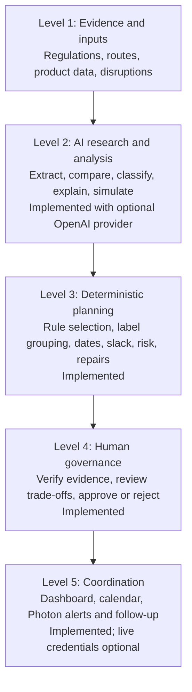
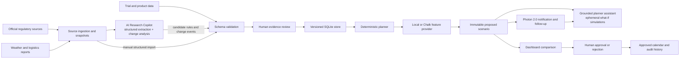

# Cleared for Takeoff

Local clinical-supply decision support: dated regulatory evidence, compatible label groups, dependency schedules, change scenarios, human approval and audit history. The packaged trial is a **synthetic demonstration** with a four-jurisdiction official evidence slice; it is not legal advice or ready for operational use.

The product deliberately combines two kinds of intelligence. Deterministic code owns calculations that must be reproducible. AI is reserved for uncertain, language-heavy work such as interpreting source documents, identifying meaningful changes, and explaining scenarios. A human remains responsible for evidence verification and plan approval.

## Product decision levels



AI may propose structured candidates and scenario questions, but it may not verify a regulation, perform the authoritative schedule calculation, or approve a plan. This boundary keeps the system useful when model access is unavailable and makes every operational result reproducible.

## Architecture



The implementation covers AI-assisted candidate extraction and semantic source-change analysis, validated structured inputs, deterministic what-if simulation, planning, comparison, approval, audit, calendar export, and Photon 2.0 alerts/follow-up. AI and Photon are optional and fail safely when they are not configured. A credentialed live-provider smoke test remains before the demo. Detailed product decisions and the prioritized work list are in [`PLANNING_NOTES.txt`](PLANNING_NOTES.txt).

## Start

Prerequisite: **Python 3.11+**. No runtime package installation, Docker, cloud service, model key, Chalk or Photon credentials are needed. The Windows launcher also detects Codex's bundled Python.

Clone the team branch on any laptop, then enter the repository:

```powershell
git clone --branch cleared-for-takeoff https://github.com/oliverywu/hackharvard.git
cd hackharvard
```

From the repository root in PowerShell:

```powershell
.\start.ps1
```

If PowerShell blocks scripts, run `powershell -ExecutionPolicy Bypass -File .\start.ps1`. Portable equivalent: `python start.py` (or `python3 start.py`).

The command initializes/migrates SQLite, loads the demo if empty, generates the baseline, starts both services, and prints:

- Website: **http://localhost:3000**
- API: **http://localhost:8000**
- Database: `.local/cleared.sqlite3`

Both services bind to loopback. Keep the terminal running; Ctrl+C stops both. Normal restart preserves data. Choose alternate ports with `-WebPort 3001 -ApiPort 8001` or Python's `--web-port 3001 --api-port 8001`. An occupied port produces a clear error. `HOST` must be changed explicitly to expose the app beyond the laptop.

## Run the demo

1. Open **Control tower**: 24 countries, Boston origin, a fictional blinded oral-tablet product, sites, depots, enrollment and demand. The baseline is feasible. The data supplies a frozen planning date for repeatability.
2. Open Germany in the country grid. Select a requirement for its exact source excerpt, effective interval and review state. Inspect the milestone timeline.
3. In **Scenarios**, analyze the Japanese mandatory-label-field event. Inspect the shared label and delayed review, packaging and dispatch. Create the recommended separate-label repair and review its cost/schedule trade-offs.
4. **Approve** with your reviewer name and decision note. Only this human decision updates the current approved plan.
5. Analyze the Boston–Frankfurt weather event. Compare its delayed customs/depot/site dates with the configured Amsterdam alternative. Creating an alternative remains a proposal until approved.
6. In **Planner assistant**, select the proposal and ask why the destination is at risk. Answers use stored calculations and evidence.
7. View **Audit history**, then download **Approved calendar (.ics)** in Scenarios.

The **Control tower** includes a monthly supply calendar populated from the selected scenario's projected milestones. Select the latest event proposal to see its changed dates before approval. Select any calendar item to add that milestone directly to Google Calendar or Outlook. The full `.ics` export contains every milestone and is available for approved scenarios, so it can be imported into either calendar service.

Selecting a country opens its requirements and delivery progress. The progress tracker shows the current planned stage, business-day duration for every step, projected dates, and remaining shipment slack. Orange delay-exposure labels identify milestones affected by the selected event or a shipment with low slack. These labels explain stored scenario risk; they are not probabilistic forecasts.

The backup event increases Canada's permit lead time. All event names, affected jurisdictions, delays and repairs come from data records.

Reset with the Control tower button, or stop the app and run `.\start.ps1 -Reset`. Reset activates a fresh synthetic baseline while retaining historical scenario/audit snapshots. For the alternative fixture: `python start.py --db .local/replacement.sqlite3 --fixture data/demo/replacement.json`. Add `--reset` to explicitly replace an existing demo database.

## Teammate research and replacement data

Use **Data & research**. Atomic research imports accept one or more JSON or CSV files and combine records across countries into one reviewable preview. The preview reports record, country, addition, supersession, needs-review, and duplicate-conflict counts. Full dataset imports take one complete JSON object because a dataset is an atomic workspace containing all countries and trial inputs. Both paths require **Validate & preview** before **Commit** with reviewer attribution. Downloadable templates are available in the screen and under `data/schemas/`.

See `data/schemas/` and complete working examples `data/demo/trial.json` and `data/demo/replacement.json`. `GET /api/dataset` exports the active dataset as a template. Replace the JSON records or import them; no application changes or fixture-builder execution are required.

| Atomic rule fields | Meaning |
| --- | --- |
| `id`, `jurisdiction`, `rule_type` | Stable record ID, known jurisdiction and category |
| `requirement_key`, `operator`, `value` | Typed requirement and value |
| `effective_from`, optional `effective_to` | Inclusive start, exclusive end; ISO dates |
| `source_url`, `source_title`, `source_excerpt` | Exact citation and retained evidence |
| `retrieved_at`, `source_tier`, `confidence`, `review_status` | Provenance and review state |

Complete datasets contain `id`, `as_of`, `trial` (including `product`), `config`, `jurisdictions`, `country_plans`, `rules`, `routes`, and `events`. Country plans hold site/depot, enrollment, demand/quantity, ready date, delivery target and holidays. Routes hold legs, transit/customs/depot/last-mile durations, temperature band, cost and source. Configuration controls booklet capacity and risk/readiness weights. Events describe normalized changes and repair choices.

The interface distinguishes **verified**, **needs review**, **authoritative secondary** and **synthetic**. New research should remain `needs_review` until qualified human review; synthetic sources cannot be marked verified. Select a requirement in **Requirements**, enter a reviewer name and note, then verify, retain for review, or retire it. The decision creates a new immutable rule version and regenerates a proposed plan. Existing approved snapshots retain their original inputs.

The packaged Japan view also includes six atomic Article 16 candidates linked directly to the current official MHLW Japanese text: mandatory label fields, prohibited claims, the foreign-sponsor/in-country-caretaker condition, emergency unblinding, transport/storage packaging integrity, and investigational-product records/procedures. They appear first with an **Official** evidence link and **Needs review** badge. They intentionally do not replace the active synthetic planning assumptions until a qualified reviewer confirms the translation, scope, and effective-date applicability. Article 16 does not establish the fixture's numeric temperature band, review/permit lead times, packaging duration, or expiry display format.

The **Source registry** records official HTTPS pages and supports generic-page, eCFR, and EUR-Lex adapters. **Check now** collects the page, stores a content hash, and creates a diff/change event when content changes. Network access is only used when a teammate clicks the control. Extracted candidates remain `needs_review`; a text diff does not establish a verified legal change. Manual pasted snapshots remain available for pages that block automated collection.

## Planner assistant and AI boundary

The planner assistant works offline by default. Its deterministic answers cite the selected immutable scenario and source records. Ask with a full country name (`Why is Argentina at risk?`) or an uppercase two-letter code (`Why is DE at risk?`). Full names take priority, so ordinary words such as “at” are never interpreted as country codes. Answers lead with the direct cause, dates, slack, and scenario impact; repeated causal text is removed. Negative slack is expressed as business days late rather than a negative number. To enable a model-written answer, copy `.env.example` to `.env` and set:

```dotenv
ASSISTANT_PROVIDER=openai
OPENAI_API_KEY=your-api-key
OPENAI_MODEL=gpt-5.4-mini
```

The integration uses the OpenAI Responses API with one allowlisted, read-only planning-context tool. It cannot approve, reject, or modify plans. Citations still come from stored evidence, API failures fall back visibly to the local assistant, and responses are sent with storage disabled. Never commit `.env` or an API key.

The model integration improves explanation and prepares research candidates; it never owns an authoritative calculation or decision. The research copilot uses strict structured output to extract atomic requirements, then checks every supporting quotation verbatim against the saved source snapshot and forces every accepted candidate to `needs_review`. The change analyst compares the latest two snapshots, retains the raw diff and exact before/after citations, proposes materiality and a normalized event, and requires a named reviewer confirmation before deterministic impact analysis is enabled.

To enable both AI research flows, use the same OpenAI configuration as the planner assistant and set:

```dotenv
AI_RESEARCH_PROVIDER=openai
```

In **Data & research**, register a source with its jurisdiction, collect or paste a snapshot, and choose **Extract candidate requirements**. Candidates then pass through the existing validation/import preview and separate evidence-review workflow. After two changed snapshots exist, choose **Analyze latest change**, inspect the semantic summary, quotations, raw diff and proposed event, then record a named confirmation. OpenAI requests use the Responses API with strict JSON Schema output and storage disabled. Provider failures do not create rules or events.

Questions beginning with “What if” use an allowlisted simulation path for separate labels, alternative routes, expedited label review, and expedited permits. The selected scenario is copied in memory, the deterministic planner calculates the comparison, and the result is returned as `temporary` without creating, approving, or applying a scenario. Unsupported countries or actions produce an explicit limitation.

## Teammate handoff checklist

**The current deterministic demo runs without ChatGPT, OpenAI, Chalk, Photon, Google, or Microsoft credentials.** Planning, risk calculation, temporary what-if scenarios, approvals, audit history, the dashboard calendar, `.ics` export, and the offline planner assistant remain available locally. Configured OpenAI and Photon providers add the intended live hackathon experience but may fail safely without disabling the planning workflow.

Every imported rule should begin as `needs_review`. A qualified reviewer must inspect evidence in the UI. Dataset and rule commits generate proposals; a separate named plan approval is still required.

### Required hackathon completion work

- [ ] **Live provider smoke tests:** run one real OpenAI research/assistant flow and one real Photon notification before the demo. If the project is submitted for a Chalk category, also deploy the resolvers and verify one live query against the local parity result. Keep secrets out of Git and preserve local fallbacks.

### Required before using real trial data

- [ ] Country researchers replace synthetic rules with official or authoritative research using the CSV/JSON templates in **Data & research**. Every record needs an exact excerpt, source URL, retrieval date, and effective date.
- [ ] A qualified reviewer imports the research, resolves duplicate conflicts, and records **Verify**, **Keep in review**, or **Retire** for every rule used operationally.
- [ ] The supply-planning owner replaces demo product, demand, quantities, sites, depots, routes, ready dates, delivery targets, holidays, and risk settings in one complete dataset JSON.
- [ ] The team validates the full dataset in **Data & research**, commits it with reviewer attribution, and checks every country for missing or blocked inputs.
- [ ] The team reviews generated proposals in **Scenarios** and records a named approval or rejection with a decision note. Confirm that the dashboard calendar and country progress dates match the approved plan.
- [ ] Before a demo or handoff, run `python -m unittest discover -v`. For full UI verification, also run `npm install`, `npx playwright install chromium`, and `npm run test:browser`.

### Optional infrastructure after the hackathon workflow is complete

- [ ] **Chalk live activation:** create the hackathon project, run `chalk apply` in `chalk/`, and paste the issued client credentials and query server into `.env`. The feature contract, resolvers, parity checks, fallbacks, and Agent Evals dataset are ready.
- [ ] **Calendar account authorization:** issue delegated Google Calendar or Microsoft Graph access tokens and paste them into `.env`. Direct approved-milestone synchronization is implemented; `.ics` and one-click event links remain available without credentials.
- [ ] **Hosting:** choose a deployment host and production data/security approach only if teammates need the app while the host laptop is off. The current app intentionally runs on one laptop with SQLite and local reviewer attribution.

Never share or commit `.env`, API keys, client secrets, or the local `.local/cleared.sqlite3` database.

### Daily teammate workflow

1. Pull the branch: `git pull origin cleared-for-takeoff`.
2. Start the app with `./start.ps1` in PowerShell or `python start.py` on macOS/Linux.
3. Open `http://localhost:3000`. Keep the terminal open while using the app.
4. Import research in **Data & research**, review evidence in **Requirements**, and assess resulting dates in **Scenarios** and the Control tower calendar.
5. Stop the app with Ctrl+C. Local work is stored in `.local/cleared.sqlite3`; do not commit that database.

## Chalk

Local features support the full workflow by default. To use an existing Chalk environment, copy `.env.example` to `.env` and set:

```dotenv
CHALK_CLIENT_ID=your-client-id
CHALK_CLIENT_SECRET=your-client-secret
CHALK_ENVIRONMENT=your-environment-id
CHALK_QUERY_SERVER=https://your-environment-query-server
```

Deploy `chalk/features.py`, `chalk/resolvers.py`, and shared `packages/feature_provider/formulas.py` in your Chalk project using its SDK/tooling. The local app needs no SDK. It uses OAuth and allowlisted online feature queries from normalized primitive inputs. Resolvers calculate delivery, slack, risk and transit. An existing `CHALK_ACCESS_TOKEN` is also supported. Never commit credentials.

Credentials automatically select `ChalkFeatureProvider`. Remote/local parity is checked; authentication, connectivity, deployment or parity failures explicitly report a local fallback. `FEATURE_PROVIDER=local` forces offline mode. Historical scenario snapshots retain point-in-time feature values. **Live Chalk requires your account and deployed matching resolvers; tests verify mocked contract/formula parity, not a live account.**

The checked-in [agent evaluation set](evals/README.md) covers grounded answers, citations, refusal, temporary what-if behavior, requirement extraction, semantic change classification, and insufficient-evidence abstention. `python evals/run.py` produces a pass/fail report without credentials; the same `evals/gold.json` is ready to upload to Chalk Agent Evals for hosted runs and per-kind slices.

## Calendar and Photon

Approved-only RFC 5545 ICS export includes permit filing/approval, label review, artwork freeze, packaging start/completion, dispatch, customs arrival/release, depot arrival and site delivery. Google Calendar and Outlook buttons can directly synchronize the complete approved milestone set when their server-side delegated access token is configured. Provider results are audited, and failures cannot modify approval or plan data.

```dotenv
GOOGLE_CALENDAR_ACCESS_TOKEN=delegated-token-with-calendar-events-write
GOOGLE_CALENDAR_ID=primary
MICROSOFT_GRAPH_ACCESS_TOKEN=delegated-token-with-Calendars.ReadWrite
```

Photon is isolated behind `NotificationProvider` and disabled by default. The implementation follows Photon 2.0's User → Space → Message model and supports iMessage, SMS, RCS, WhatsApp, Telegram, or email according to the channel configured in the Photon dashboard. Scenario analysis sends the trigger, projected consequence, review status, and deep link; `POST /api/photon/follow-up` lets an inbound-message bridge return a grounded answer in the same space. Every send/reply result is audited, HTTP 202 is reported honestly as accepted rather than delivered, and failures never modify a plan or approval.

Create a Photon 2.0 beta project and channel, then configure:

```dotenv
PHOTON_ENABLED=true
PHOTON_API_KEY=your-api-key
PHOTON_PROJECT_ID=your-project-id
PHOTON_AGENT_USER_ID=your-agent-user-id
PHOTON_RECIPIENT=+14155550123
PHOTON_PLATFORM=imessage
```

The [Photon hackathon guide](https://somethingreat.notion.site/Hackathon-Guidelines-for-Photon-2-0-3f8e443f36bb81f9893fed0d08a4c01d) requires a project to be live on at least one Photon channel; iMessage is the flagship text path, while voice must use an SMS number. Credentials and a real channel are intentionally not committed, so the live smoke test remains a pre-demo checklist item.

## Tests

All deterministic, integration, contract and full HTTP demo tests use the standard library:

```powershell
python -m unittest discover -v
```

Use `py` or your Python executable if necessary. Tests use temporary databases and available loopback ports, leaving the running demo database untouched. The HTTP test starts the real launcher and verifies both disruptions, repairs, approval, audit, calendar export and a distinct replacement dataset.

Optional browser acceptance tests require Node.js 20+ and Playwright (downloads are only for test tooling):

```powershell
npm install
npx playwright install chromium
npm run test:browser
```

The browser suite starts an isolated database, exercises the UI, checks mobile overflow and uncaught errors, and writes screenshots into `test-results/`. `CFT_PYTHON` selects a Python executable; `PLAYWRIGHT_CHROMIUM_EXECUTABLE` selects an existing Chromium installation.

## Architecture and limits

The standard-library API, SQLite and buildless browser app keep offline startup simple. SQLite is appropriate for this single-laptop, single-user hackathon workflow: it needs no server or credentials and still provides transactions, constraints, WAL mode, and immutable-snapshot triggers. PostgreSQL would become useful for a hosted multi-user deployment with concurrent writers, account isolation, centralized backups, and operational monitoring. Adding it now would introduce deployment work without improving this demo, so it is intentionally deferred.

This is a single-user local tool. Reviewer names are attribution, not production authentication. Holiday calendars, route estimates and evidence quality depend on imported records. The assistant remains usable without a model-service dependency. Source checks are user-triggered and only run while the application and laptop are on.

Conversational what-if analysis, the focused official evidence slice, Photon 2.0 messaging, the agent evaluation set, changed-only review, Chalk deployment contract, and direct calendar providers are implemented. Only credentialed live activation and smoke tests remain. See [planning notes](PLANNING_NOTES.txt), [architecture](docs/architecture.md), [provenance](docs/data_provenance.md), [demo script](docs/demo_script.md), and the original [challenge brief](CHALLENGE_BRIEF.txt).
