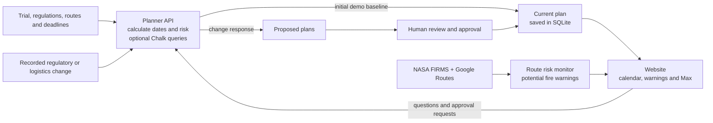

# ClearPath

**Problem:** Country-specific regulations and logistics disruptions delay international
clinical-trial drug shipments, putting patients at risk of missed doses.

**Solution:** ClearPath combines regulatory and shipment data to flag delivery risks,
automatically proposes adjusted plans, and alerts pharmaceutical teams so that they can review
changes before delivery deadlines are missed.

The application includes:

* **Website** — the frontend (in the existing `cleared-for-takeoff/cleared-for-takeoff-app`
  directory), the only user-facing UI. Its Node server also handles map and fire-monitor requests.
* **Unified planner API** — the planner (`planner/`) serving planning and decision routes, with
  Chalk features (`planner/chalk`, `planner/packages/feature_provider`) and the
  messaging and decision agent (`messaging/`) running in-process.
* **One database** — `.local/cleared.sqlite3` owns proposals, the current plan, approvals,
  evidence, conversations and the audit history.

## Visual overview

This diagram shows the current integrated app:



Route fire warnings flag potential hazards; they do not automatically change the current plan.
For endpoint details and the website-to-planner boundary, see the
[integration architecture](docs/integration.md). The diagrams in the
[planner README](planner/README.md) describe that module in more detail.

## How we used the event sponsors

| Sponsor | Use in ClearPath |
|---|---|
| **Chalk** | Shipment feature definitions calculate projected delivery, safe ship-by dates, slack and risk from planning inputs such as transit, customs timing and holidays. The app can query deployed Chalk features online, checks returned values against its local formulas, and records when it falls back to local calculations. The calendar insight uses the feature values stored with the current plan. |
| **SpaceX / Grok** | Our team used Grok while building the global shipment visualization and mapping experience, and Grok Imagine to create the demo video shown in our presentation. The running map uses Google Maps/Routes; route hazards come from NASA FIRMS fire detections, LANCE One Pager (NASA) GDACS disaster alerts and NASA LANCE NRT Observations for Disaster Risk Reduction (NTRS).
The app does not call a Grok API at runtime. |
| **Photon** | Photon provides the optional messaging channel for proactive shipment alerts and iMessage replies. The Max conversation connects incoming replies to shipment context, previews proposed fixes and passes approval requests through the planner's role checks. The same workflow is available in the web app without a phone connection. |
| **Anthropic / Claude** | Claude is used in the regulatory agent to extract cited requirements from source text, compare requirements across jurisdictions and answer free-text questions with retrieved passages when configured. The app separately detects changes between saved regulatory snapshots; plan approvals remain governed by the planner. |

External services require the corresponding credentials and configuration described below; the
local demo keeps its deterministic planning and web workflow without them.

## Run it (fresh clone)

Prerequisites: **Python 3.11+** and **Node.js 22.13+** (`python --version` or
`py -3 --version` on Windows, and `node --version`). The core local demo needs no
Python package installation. Use Node 22.13 or newer even if the launcher accepts
an older version; the website uses `node:sqlite`.

```bash
git clone https://github.com/oliverywu/ClearPath.git
cd ClearPath
python start.py            # macOS / Linux  (python3 start.py if needed)
```

Windows (PowerShell or double-click):

```powershell
.\start.ps1                # or start.cmd
```

`start.py` validates prerequisites and ports, creates or migrates the database, starts the API and
the website, and prints:

```
Website: http://localhost:3000
API:     http://localhost:8000   (browser uses /api on the website origin)
```

Open **http://localhost:3000**. Ctrl+C stops both processes. Options: `--check` (validate only),
`--reset` (re-seed the synthetic demo dataset; history is kept), `--web-port`, `--api-port`, `--db`.

## Try the governed workflow

1. Open **Warnings** (click the "Drug late" capsule): three synthetic disruptions are `in review`.
2. Introduce a new disruption (it calculates proposals but does not change the current plan):
   ```bash
   curl -X POST localhost:3000/api/change-events -H 'Content-Type: application/json' -d '{
     "id":"jp-port-closure","title":"Japan · Narita cargo terminal closure","event_type":"logistics",
     "jurisdiction":"JP","synthetic":true,"description":"Simulated NRT closure adds 6 business days.",
     "transit_delay_days":6,"repair_options":[{"id":"jp-express","action":"alternative_route",
     "route_id":"demo-JP-express","title":"Use the priority direct lane","description":"Express lane.",
     "tradeoffs":"Higher transport cost."}]}'
   ```
3. Open **Max** (bottom-right) → **Kenji** (Japan affiliate): reply `1` to preview, then `APPROVE` —
   refused, because Kenji cannot approve.
4. Open **Maya** (supply lead): reply `1`, then `APPROVE`. The planner moves the current plan to
   version 2; Kenji receives a plan-update message; the warning shows `resolved` with the decision
   in its audit history.

## Configuration (optional)

`start.py` reads `.env` at the repository root and passes those values to both
the website and planner API. Copy the **root** `.env.example` to `.env`
(gitignored), then fill in the services you use. The examples inside `planner/`
and `cleared-for-takeoff/cleared-for-takeoff-app/` are for running those parts
separately. The website can also read its own `.env.local`, but that file is not
passed to the planner API. System environment variables take precedence.

For **Claude answers or inbound Photon messages**, install the optional Python
dependencies in the same Python environment that runs `start.py`:

```bash
python -m pip install -r messaging/requirements.txt
```

On Windows, use `py -3 -m pip` if you launch with `start.ps1` and `py -3` selects
your Python installation.

| Variable | Effect |
|---|---|
| `CHALK_CLIENT_ID`, `CHALK_CLIENT_SECRET`, `CHALK_ENVIRONMENT`, `CHALK_QUERY_SERVER` | Chalk online feature queries (parity-checked; local fallback otherwise) |
| `PHOTON_ENABLED=true` + `PHOTON_API_KEY`, `PHOTON_PROJECT_ID`, `PHOTON_AGENT_USER_ID`, `PHOTON_RECIPIENT` | outbound post-approval notifications via Photon |
| `PHOTON_BRIDGE_ENABLED=true` + `PHOTON_API_KEY`, `PHOTON_PROJECT_ID` | inbound iMessage replies routed to Max (needs `pip install -r messaging/requirements.txt`) |
| `ANTHROPIC_API_KEY` | Max answers free-text questions with the cited regulation agent |
| `GOOGLE_MAPS_API_KEY` | route-hazard analysis (Google Routes + GDACS) on the monitor page |

Never commit `.env`, keys, Photon or Google credentials, local state files or databases
(all are in `.gitignore`).

### Max on the website and by phone

**Web chat:** Open **Max** at the bottom right of `http://localhost:3000`. The
`1`/`2`/`APPROVE` decision flow is deliberately rule-based. Free-text questions use
the local grounded assistant by default; `ANTHROPIC_API_KEY` plus the messaging
dependencies enable cited AI answers from the regulation agent. Photon is not needed for web chat.

**iMessage:** Photon connects a phone conversation to that same Max workflow. The
project ID and API key authenticate the application; they do not register your
personal number or provide an agent number. To set up phone chat:

1. In the Photon dashboard, create a project and a project API key with
   `project:read` and `project:write` permissions. In its iMessage section,
   add your phone number or Apple email as a sender identity and assign a
   shared line. Note the assigned line's number; that is the number you will
   text. See [messaging/README.md](messaging/README.md#photon-setup-for-the-optional-imessage-bridge)
   for the Beta dashboard steps. Dashboard labels may differ in Photon 2.0.
2. Set `PHOTON_PROJECT_ID`, `PHOTON_API_KEY`, and `PHOTON_BRIDGE_ENABLED=true` in
   the ignored repository-root `.env`. Use the optional dependency install
   command above for the Python environment that launches the app.
3. Restart the app and confirm its startup message says `Photon bridge: on`.
   Leave the app running, then send an iMessage from your registered phone to
   the assigned Photon line. Max's reply should arrive in that thread.

Your personal phone number is configured in Photon, not in `.env` for
incoming chat. For outbound shipment alerts, the website uses
`PHOTON_SENDER_ID` (the sending user) and `PHOTON_SPACE_ID` (the default
recipient space); set them in its `.env.local` or the repository-root `.env`.
The integrated planner uses `PHOTON_ALERT_SENDER_ID` when sending an alert to
an existing Photon chat. These IDs come from the Photon project, not your
personal phone number. The current local phone bridge has not been verified
against a live Photon account.

## Tests

```bash
python run_tests.py              # everything below
```

| Suite | Command | What it covers |
|---|---|---|
| Planner + integration | `cd planner && python -m unittest discover -s tests` | planner unit/integration/e2e, Chalk outlook, API contracts, adapters, schemas, governance, authorization, idempotency, stale/conflicting approvals, evidence, messaging integration, provenance, provider failure, planner regression and Chalk parity |
| Messaging | `cd messaging && pip install -r requirements.txt && python -m pytest` | regulatory agent and planner-backed conversation unit tests |
| Browser end-to-end | `python -m unittest tests.e2e.test_browser_workflow` | the full workflow in Chromium via `start.py`; API-down error state; `?mock=1` |
| Fresh clone | `python -m unittest tests.e2e.test_fresh_clone` | clone the committed tree and start it |

Browser tests need `pip install playwright && python -m playwright install chromium`.

## Mock mode

For isolated frontend development without the backend, open the website with `?mock=1`
(uses `src/mock/*.json`; scripted Max replies exist only in this mode).
